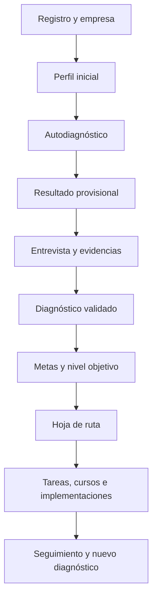
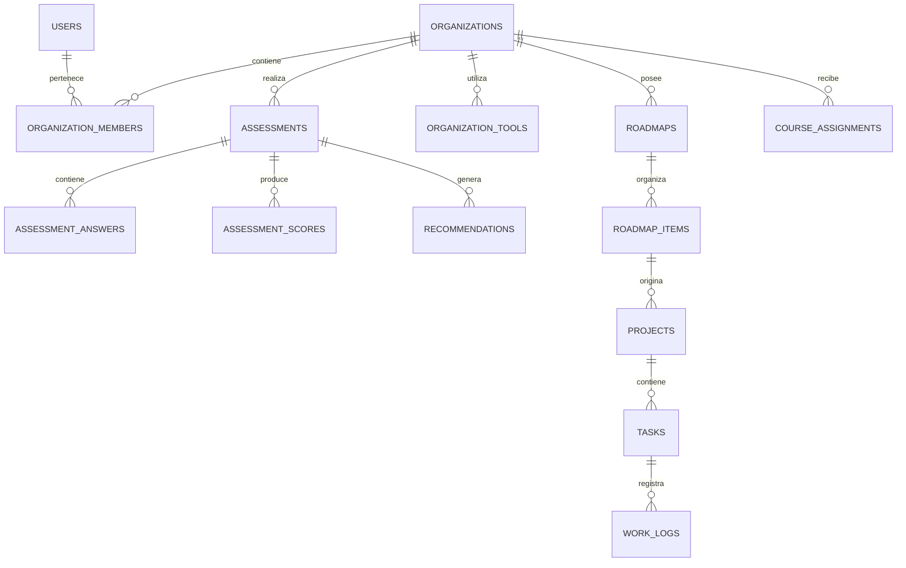

# Nexaro — Especificación base del MVP

## 1. Objetivo

Crear una plataforma multiempresa donde un autónomo o pyme pueda:

1. registrarse e iniciar sesión;
2. crear o completar el perfil de su empresa;
3. responder el diagnóstico de madurez digital basado en el marco europeo DMAT;
4. recibir un resultado provisional y pasar por una validación de Nexaro;
5. consultar su nivel actual, resultados por dimensión y evolución histórica;
6. declarar y mantener el inventario de herramientas digitales que utiliza;
7. consultar su hoja de ruta, tareas, implementaciones y cursos asignados;
8. ver qué trabajos realizó Nexaro, su estado, entregables, costes y próximos pasos.

El sistema deberá conservar por separado el **resultado oficial calculado con las reglas DMAT** y las **recomendaciones contextuales de Nexaro**.

## 2. Roles iniciales

| Rol | Alcance |
|---|---|
| Cliente propietario | Administra su empresa, invita usuarios, responde diagnósticos y consulta todo su plan. |
| Cliente colaborador | Completa información y tareas según los permisos concedidos. |
| Consultor Nexaro | Valida respuestas y evidencias, crea la hoja de ruta y gestiona tareas. |
| Administrador Nexaro | Gestiona empresas, usuarios, cuestionarios, catálogo, reglas y configuración. |

Una persona puede pertenecer a más de una empresa. Todos los registros empresariales deben incluir `organization_id` para impedir que una empresa vea información de otra.

## 3. Módulos de la interfaz

| Módulo | Función principal | Primera versión |
|---|---|---|
| Acceso | Registro, inicio de sesión, recuperación de contraseña y aceptación legal | Sí |
| Perfil | Datos de empresa, sector, tamaño, objetivos, responsables y contexto | Sí |
| Diagnóstico | Preguntas por dimensión, guardado automático y progreso | Sí |
| Resultado | Nivel global, seis dimensiones, confianza y alertas | Sí |
| Evolución | Comparación de diagnósticos validados a través del tiempo | Sí |
| Herramientas | Inventario actual, uso, coste, integración, responsable y criticidad | Sí |
| Hoja de ruta | Acciones ordenadas por fases, prioridad, dependencia y KPI | Sí |
| Tareas | Pendientes del cliente y de Nexaro, estados, fechas y evidencias | Sí |
| Cursos | Formación asignada por brecha o necesidad y avance del participante | Sí |
| Trabajo Nexaro | Implementaciones, entregables, actividad, costes y mantenimiento | Sí |
| Administración | Empresas, usuarios, versiones del cuestionario, reglas y catálogos | Sí, interna |

## 4. Flujo principal

## 5. Modelo de datos relacional

Se recomienda una base relacional compatible con PostgreSQL. Los identificadores pueden ser UUID y todas las tablas operativas deben registrar `created_at`, `updated_at` y, cuando corresponda, `created_by`.

### 5.1 Identidad y empresas

| Tabla | Propósito | Campos principales |
|---|---|---|
| `users` | Identidad de cada persona | id, email, nombre, estado, último acceso |
| `organizations` | Autónomo, pyme u otra entidad cliente | id, nombre legal, nombre comercial, tipo, país, sector, tamaño, zona horaria, estado |
| `organization_members` | Relación usuario–empresa y permisos | organization_id, user_id, rol, estado, fecha de invitación |
| `organization_profiles` | Contexto ampliado del negocio | organization_id, actividad, empleados, facturación_rango, canales, objetivos, restricciones |

### 5.2 Cuestionario y diagnóstico

| Tabla | Propósito | Campos principales |
|---|---|---|
| `questionnaire_versions` | Congela cada versión del diagnóstico | id, nombre, versión, marco, fecha_vigencia, estado |
| `dimensions` | Las seis dimensiones DMAT | id, questionnaire_version_id, código, nombre, orden, peso |
| `questions` | Preguntas versionadas | id, dimension_id, código, texto, tipo, orden, obligatoria |
| `question_options` | Opciones y valor oficial | id, question_id, texto, score_value, orden |
| `assessments` | Una ejecución del diagnóstico | id, organization_id, questionnaire_version_id, estado, started_at, submitted_at, validated_at |
| `assessment_answers` | Respuesta declarada | assessment_id, question_id, option_id o valor, comentario, answered_by |
| `assessment_evidence` | Documentos, enlaces o notas de comprobación | assessment_id, answer_id, tipo, referencia, estado_validación, reviewed_by |
| `assessment_scores` | Resultado calculado y reproducible | assessment_id, dimension_id, score, nivel, tipo_resultado, fórmula_version |
| `assessment_reviews` | Entrevista y validación de Nexaro | assessment_id, consultor_id, observación, decisión, fecha |
| `diagnostic_alerts` | Riesgos críticos independientes del puntaje | assessment_id, regla_id, severidad, estado, explicación |

Estados de `assessments`: `draft`, `submitted`, `under_review`, `validated`, `superseded`.

Tipos de `assessment_scores`: `provisional` y `validated`. La interfaz muestra claramente cuál está vigente; el historial conserva ambos para auditoría.

### 5.3 Reglas y recomendaciones

| Tabla | Propósito | Campos principales |
|---|---|---|
| `diagnostic_rules` | Convierte respuestas en necesidades o alertas | id, versión, condición, aplicabilidad, resultado, severidad, activa |
| `recommendations` | Recomendación generada para una empresa | organization_id, assessment_id, regla_id, tipo, título, fundamento, prioridad |
| `company_goals` | Meta elegida por el cliente | organization_id, dimensión, objetivo, indicador, valor_objetivo, fecha_objetivo |
| `roadmaps` | Plan aprobado y versionado | organization_id, assessment_id, versión, estado, fecha_inicio, horizonte |
| `roadmap_items` | Acción concreta del plan | roadmap_id, recomendación_id, fase, responsable, prioridad, dependencia, KPI, coste_estimado |

La prioridad se calculará con impacto, riesgo, urgencia, dependencia y facilidad, pero Nexaro podrá justificar y registrar un ajuste manual.

### 5.4 Herramientas actuales

| Tabla | Propósito | Campos principales |
|---|---|---|
| `tool_catalog` | Catálogo reutilizable de productos y categorías | id, nombre, categoría, proveedor |
| `organization_tools` | Herramientas declaradas o verificadas en cada empresa | organization_id, tool_id, uso, área, responsable, usuarios, coste, criticidad, estado, verified_at |
| `tool_integrations` | Integraciones entre herramientas | organization_id, source_tool_id, target_tool_id, método, estado, última_verificación |

Estados sugeridos: `planned`, `trial`, `active`, `limited`, `retiring`, `retired`.

### 5.5 Ejecución, tareas y trabajo de Nexaro

| Tabla | Propósito | Campos principales |
|---|---|---|
| `projects` | Implementación o iniciativa | organization_id, roadmap_item_id, nombre, alcance, estado, fechas, presupuesto |
| `tasks` | Trabajo asignable al cliente o a Nexaro | project_id, organization_id, título, tipo, responsable, estado, prioridad, vencimiento |
| `task_activity` | Historial inmutable de cambios y comentarios | task_id, actor_id, evento, detalle, created_at |
| `deliverables` | Entregables y aceptación | project_id, task_id, nombre, referencia, versión, estado, accepted_at |
| `work_logs` | Trabajo realizado por Nexaro | task_id, consultor_id, descripción, minutos, fecha, facturable |
| `service_costs` | Setup, abono y consumo variable | organization_id, project_id, concepto, tipo, importe, moneda, período, estado |

Estados de tarea: `backlog`, `ready`, `in_progress`, `blocked`, `client_review`, `done`, `cancelled`.

### 5.6 Cursos y capacitación

| Tabla | Propósito | Campos principales |
|---|---|---|
| `courses` | Catálogo original de Nexaro | id, título, nivel, duración, modalidad, estado |
| `course_competencies` | Brechas o capacidades cubiertas | course_id, dimensión, competencia |
| `course_assignments` | Curso asignado por diagnóstico o plan | organization_id, user_id, course_id, assessment_id, motivo, fecha_límite, estado |
| `course_progress` | Avance y evidencia de aprendizaje | assignment_id, porcentaje, evaluación, completed_at, evidencia |

## 6. Relaciones esenciales

## 7. Pantalla de inicio del cliente

El tablero del perfil debe responder cinco preguntas sin obligar al usuario a navegar:

1. **¿Dónde estoy?** Nivel validado y seis dimensiones.
2. **¿Estoy mejorando?** Variación frente al diagnóstico anterior.
3. **¿Qué debo hacer ahora?** Próximas tareas y bloqueos.
4. **¿Qué está haciendo Nexaro?** Trabajo reciente, proyectos y entregables.
5. **¿Qué estoy utilizando?** Herramientas activas, costes y alertas de integración o riesgo.

## 8. Principios que no deben romperse

- Nunca modificar respuestas históricas: una corrección genera revisión y trazabilidad.
- Nunca recalcular silenciosamente un diagnóstico antiguo con una fórmula nueva.
- Versionar cuestionario, opciones, fórmulas y reglas.
- Separar datos declarados, evidencia y validación profesional.
- Separar puntuación DMAT de la recomendación contextual de Nexaro.
- Aplicar permisos por empresa y por rol en servidor y base de datos, no solo en la interfaz.
- Registrar toda acción sensible en una bitácora de auditoría.
- Minimizar datos personales y definir conservación, exportación y eliminación.
- Almacenar archivos fuera de la base; guardar en ella solo su referencia, metadatos y permisos.

## 9. Orden de construcción

### Fase 1 — Fundamento

1. Autenticación, recuperación de acceso y roles.
2. Empresa, miembros y perfil.
3. Cuestionario versionado y las seis dimensiones.
4. Respuestas, guardado parcial y cálculo provisional.
5. Panel interno para revisión y resultado validado.

### Fase 2 — Valor para el cliente

6. Tablero de resultados y evolución.
7. Metas, reglas de recomendación y hoja de ruta.
8. Inventario de herramientas.
9. Proyectos, tareas, actividad y entregables Nexaro.

### Fase 3 — Servicio recurrente

10. Cursos asignados y seguimiento.
11. Costes recurrentes, setup y consumo variable.
12. Notificaciones, revisiones periódicas y nuevo diagnóstico.
13. Métricas operativas y automatizaciones.

## 10. Alcance del primer prototipo navegable

El primer prototipo deberá incluir ocho vistas:

1. Registro e inicio de sesión.
2. Alta o selección de empresa.
3. Perfil de empresa.
4. Diagnóstico por dimensiones.
5. Resultado provisional.
6. Panel del cliente.
7. Inventario de herramientas.
8. Hoja de ruta y tareas.

El prototipo puede utilizar datos simulados, pero sus nombres y relaciones deben coincidir con este modelo para evitar rehacer la interfaz al conectar la base real.

## 11. Próxima decisión técnica

Antes de programar hay que elegir la arquitectura de implementación:

- **Opción recomendada para el MVP:** aplicación web responsive, API de servidor y PostgreSQL, con autenticación gestionada y almacenamiento privado de evidencias.
- Mantener la lógica de puntuación y reglas en el servidor, cubierta por pruebas automáticas.
- Diseñar desde el inicio como multiempresa, aunque el primer cliente tenga un solo usuario.

El siguiente entregable será el **diccionario de datos y esquema SQL inicial**, seguido por los wireframes de las ocho vistas.
